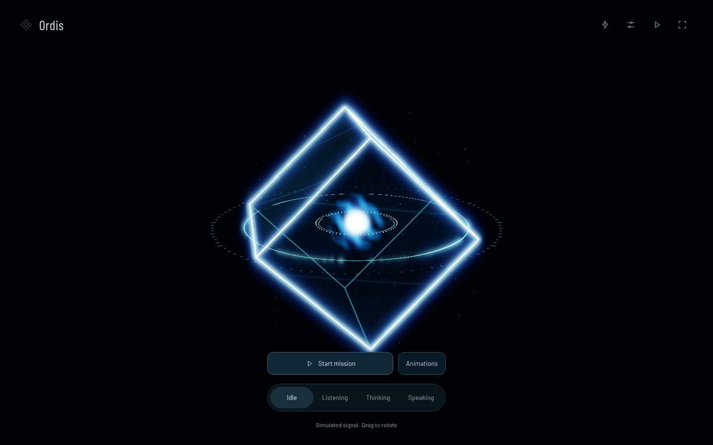

# Céphalon

[Contributing](CONTRIBUTING.md) · [Architecture](docs/architecture.md) · [Roadmap](docs/roadmap.md)

A desktop companion you can call by name, talk to, and ask to coordinate work
through specialized agents. **Ordis is the default persona of this draft**,
with “Hey Ordis” as its planned wake phrase. The companion’s name, voice and style
are intended to be customizable; profile selection is not implemented yet.



## Project status

Céphalon is an early draft. **The browser avatar playground works today.**
The resident desktop host, global activation, native overlay and agents are
planned; they are not implemented yet. No desktop framework, agent SDK or model
provider has been selected.

| Available now | Planned |
| --- | --- |
| Three.js avatar, animation profiles and audio analysis | Resident host, global shortcut and wake word |
| Browser tools for tuning appearance and animation | Native overlay above other applications |
| Versioned avatar event bridge | Conversational Ordis agent and brain orchestrator |
| Fictional local mission with computed results | Specialized agents, starting with computer use |
| Included demo voice packs with separate rights notices | Live speech, configurable name, voice and visual style |

## Try the playground

You need Node.js 20+ and npm. Three.js and fonts are included. No API key, Python
installation or voice model is needed for the playground.

```bash
git clone https://github.com/IsmailAzzouz/Cephalon.git
cd Cephalon
npm ci --ignore-scripts
npm run dev -- --host 127.0.0.1
```

Open **http://localhost:5173/**. The interface and project documentation are in English. The optional French
voice collection retains its original spoken dialogue and transcripts.

| URL | What to explore |
| --- | --- |
| `/?debug` | Optical settings |
| `/?animation=summon` | Animation profiles and specialist presence |
| `/?showcase=1` | A short sequence of avatar actions |
| `/?mission=1` | A fictional signal investigation; works without voice files |
| `/src/review.html?stage=7` | Standalone avatar view |

The repository includes generated demo voice packs and four game recordings.
**These media are excluded from the MIT License.** See the
[attributions and scope](THIRD_PARTY_NOTICES.md) before reusing them. Model weights
are not bundled. Voice generation is an [optional local tool](tooling/voice/README.md);
no model is downloaded automatically. The mission also works without narration
if its voice pack is absent.

Other commands:

```bash
npm test
npm run build
npm run preview -- --host 127.0.0.1
```

The build produces a static playground in `dist/`, including demo media and their
license exclusions and attribution notices. To preview on another device,
use `npm run dev -- --host 0.0.0.0` and the local address printed by the server.
This development server has no authentication; use it on a trusted local network.

## How the project is organized

The planned conversation agent will use a chosen profile, with Ordis as the draft
default. The brain owns the plan, delegates work and checks results.
Specialists carry out bounded missions using tools. The desktop
host manages activation, audio and screen presence independently of these agents.
The crystal is their visual representation.

```text
apps/companion/       Resident host, overlay and settings — planned
apps/runtime/         Agent application — planned
agents/               Conversation agent, brain and specialists — planned
presets/              Persona boundaries; Ordis is the default draft profile
packages/avatar/      Working renderer, animation and avatar event bridge
packages/contracts/   Existing avatar v1 types
packages/             Reserved runtime, tool and integration boundaries
platform/             OS integration boundaries — planned
examples/             Browser playground and fictional signal mission
tooling/voice/        Optional offline voice generation
docs/                 Architecture, decisions and implementation roadmap
```

Hiding Ordis, interrupting speech and cancelling a task are separate actions.
The [architecture](docs/architecture.md), [agent roles](docs/agent-roles.md) and
[protocol notes](docs/protocol.md) describe these boundaries. The existing avatar
v1 contract is not the full protocol for the future companion.

## Contribute

Start with [CONTRIBUTING.md](CONTRIBUTING.md) and the [roadmap](docs/roadmap.md).
Useful work includes improving documentation, testing the playground in browsers,
and investigating a first desktop integration. Discuss architecture changes in
an issue before starting a large implementation.

- [Report a bug or propose an idea](https://github.com/IsmailAzzouz/Cephalon/issues)
- [Avatar guide](docs/avatar-guide.md)
- [Agent event integration](docs/AGENT_INTEGRATION.md)
- [Security policy](SECURITY.md)

## License and attribution

Original project code and documentation are under the [MIT License](LICENSE).
Third-party components retain their own licenses: Three.js uses MIT and Barlow
fonts use SIL OFL 1.1. See [THIRD_PARTY_NOTICES.md](THIRD_PARTY_NOTICES.md) for scope,
attribution and voice assets excluded from MIT.

The default Ordis profile is inspired by Warframe. Céphalon is an independent
project and is not affiliated with Digital Extremes. The project license does not grant rights
to Warframe names, characters, recordings or other third-party material.
